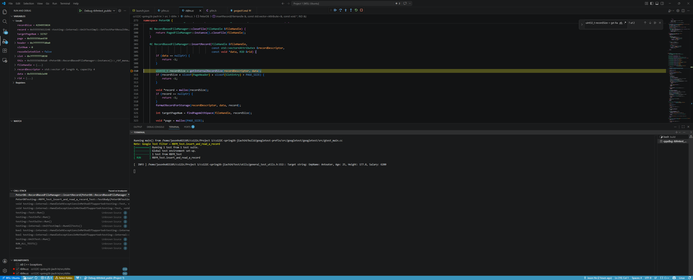
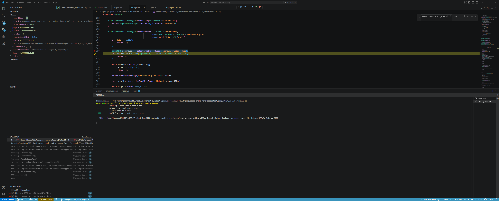
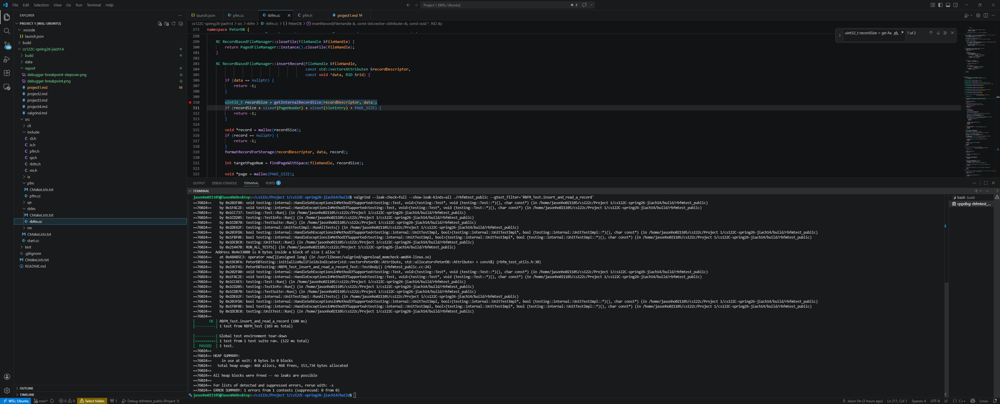

## Debugger and Valgrind Report

### 1. Basic information
 - Team #: 19
 - Github Repo Link: https://github.com/jiach14/cs122C-spring26-jiach14.git
 - Student 1 UCI NetID: jiach14
 - Student 1 Name: Jason He
 - Student 2 UCI NetID (if applicable): songhag
 - Student 2 Name (if applicable): Songhao Gao

### 2. Using a Debugger
- Describe how you use a debugger (gdb, or lldb, or CLion debugger) to debug your code and show screenshots. 
For example, using breakpoints, step in/step out/step over, evaluate expressions, etc. 

I used the VS Code C++ debugger to debug the RBFM insert path. I created a debug configuration for `rbfmtest_public` in `.vscode/launch.json` and ran the test executable with the Google Test filter `RBFM_Test.insert_and_read_a_record`.
I placed a breakpoint in `RecordBasedFileManager::insertRecord` at the line where the record size is calculated:
`uint32_t recordSize = getInternalRecordSize(recordDescriptor, data);`

When the breakpoint was hit, I inspected local variables such as `recordSize`, `slotNum`, `page`, `header`, and `recordDescriptor`. I then used Step Over to move to the next line and confirm that the debugger was correctly stepping through the record insertion logic.

### 3. Using Valgrind
- Describe how you use Valgrind to detect memory leaks and other problems in your code and show screenshot of the Valgrind report.

I used Valgrind to check for memory leaks and memory-related errors in `rbfmtest_public`. On Ubuntu, I ran the following command in the build directory:
`valgrind --leak-check=full --show-leak-kinds=all ./rbfmtest_public --gtest_filter='RBFM_Test.insert_and_read_a_record'`

This runs one focused public RBFM test under Valgrind and prints the heap summary, leak summary, and error summary. I used this output to verify that memory allocated during the test was properly released and that there were no invalid memory accesses.
The Valgrind output showed that the test passed, all heap blocks were freed, and no leaks were reported.

